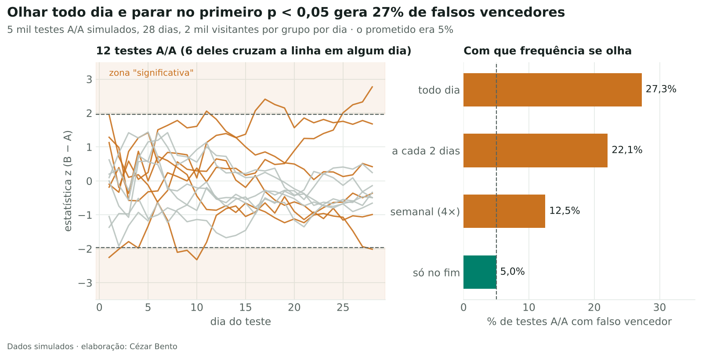
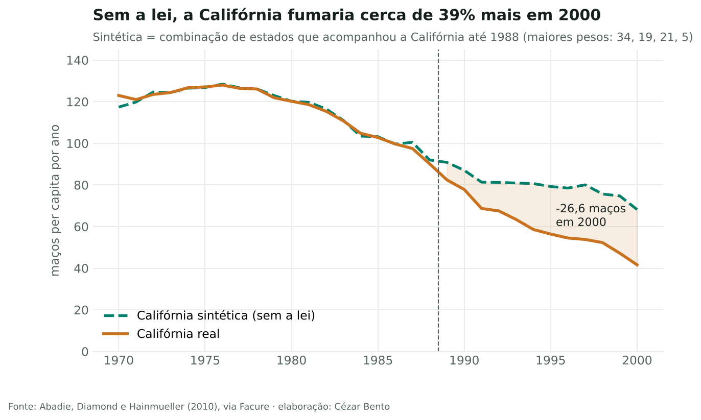
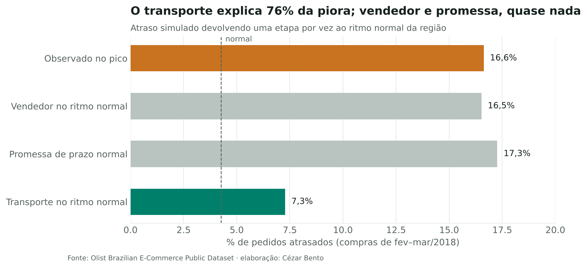

# Inferência causal aplicada

**Como saber se foi a sua ação que causou o resultado?** Três estudos, do experimento controlado ao evento que ninguém planejou. Todos usam dados públicos, implementam os métodos do zero e mostram os testes que podem derrubar a conclusão.

### [1. Teste A/B bem feito](notebooks/01_teste_ab.ipynb)
*O resultado de um teste é confiável?*<br>
Espiar o painel todo dia gera **27% de falsos vencedores** (o prometido era 5%); CUPED dá a mesma precisão com **metade dos visitantes**.<br>
Métodos: tamanho de amostra, simulação de testes A/A, O'Brien-Fleming, Holm/BH, CUPED, SRM.

### [2. Controle sintético](notebooks/02_controle_sintetico.ipynb)
*Quanto o imposto sobre o cigarro reduziu o consumo na Califórnia?*<br>
**−27 maços per capita em 2000** (−39%); antes × depois atribuiria à lei quase o triplo; evidência moderada (p ≈ 0,08).<br>
Métodos: controle sintético do zero, placebos no espaço e no tempo, retirada de doadores.

### [3. Atrasos da Olist em 2018](notebooks/03_atrasos_olist.ipynb)
*Por que os atrasos quadruplicaram? Quanto a greve dos caminhoneiros custou?*<br>
O **transporte explica 76%** da piora; a greve tirou cerca de **46% das compras** em 11 dias e atrasou os pacotes em trânsito.<br>
Métodos: decomposição taxa × composição, simulação por etapa, série temporal interrompida com Newey-West.



## O que este repositório mostra

- **O contrafactual é a decisão mais importante.** Na Califórnia, antes × depois, diferença-em-diferenças e controle sintético dão efeitos de −56, −27 e −20 maços para a mesma pergunta.
- **Testes de robustez são parte do resultado, não um apêndice.** Cada estudo traz placebos e análise de sensibilidade, inclusive quando eles enfraquecem a conclusão. Os números a reportar são faixas.
- **Causa raiz antes de causa externa.** Na Olist, os dados localizam a etapa que piorou (transporte, em todas as regiões) e descartam as explicações mais comuns (vendedor lento, promessa curta, mistura de destinos). Confirmar o motivo externo exige outro dado, e o notebook diz isso.





## Estrutura

- `src/causal/ab.py`: amostra, poder, espiadas, O'Brien-Fleming, Holm, BH, CUPED, SRM
- `src/causal/controle_sintetico.py`: pesos por NNLS com soma 1, placebos, p-valor de permutação, DiD
- `src/causal/its.py`: regressão segmentada com erros-padrão de Newey-West
- `src/causal/causa_raiz.py`: decomposição taxa × composição e simulação por etapa
- `notebooks/`: notebooks executados e os scripts que os geram (`construir_*.py`)
- `tests/`: testes com efeitos plantados; cada método precisa recuperar o valor conhecido
- `data/`: Proposition 99 e tabela de entregas da Olist
- `figures/`: gráficos usados nos notebooks e neste README

## Como rodar

```bash
pip install -r requirements.txt
pytest -q tests
# recria um notebook e seus gráficos
python notebooks/construir_02_controle_sintetico.py
```

## Dados

- **Proposition 99:** vendas de cigarro per capita em 39 estados americanos, 1970–2000, de Abadie, Diamond e Hainmueller (2010). Cópia do repositório [python-causality-handbook](https://github.com/matheusfacure/python-causality-handbook) de Matheus Facure (MIT).
- **Olist:** [Brazilian E-Commerce Public Dataset](https://www.kaggle.com/datasets/olistbr/brazilian-ecommerce) (CC BY-NC-SA 4.0). A tabela `data/olist_entregas.csv.gz` é gerada por `scripts/preparar_olist.py`.
- **Teste A/B:** dados simulados, de propósito. Só na simulação o efeito verdadeiro é conhecido, e é isso que permite medir quanto cada erro custa.

---
Cézar Bento · [portfólio](https://cezarcobaink.github.io/WebSite/) · [LinkedIn](https://www.linkedin.com/in/c%C3%A9zar-augusto-bento-a91528a8)
